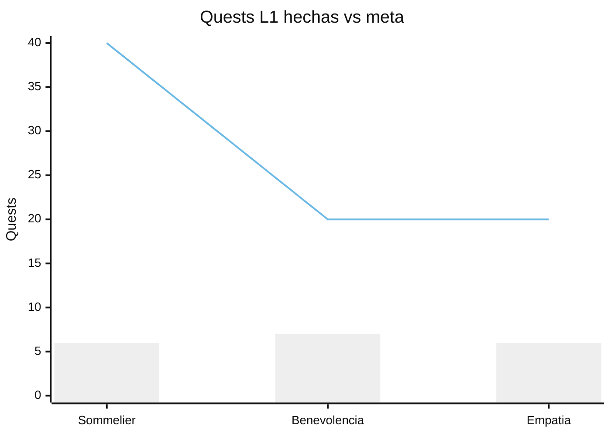
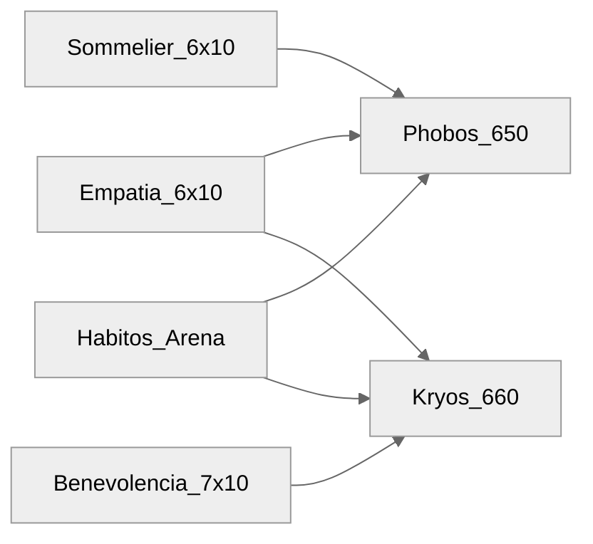

# Reporte Soulhy — Julio 2026

> Fuente de verdad: vibe-rpg (`data.json`) al **2026-07-31**.
> Visual interactivo: canvas Cursor `soulhy-julio-2026.canvas.tsx` (abrir junto al chat).
> Checklists sync: [[01_Planificacion/02_Semanal/2026-W29|W29]] · [[01_Planificacion/02_Semanal/2026-W30|W30]] · [[01_Planificacion/02_Semanal/2026-W31|W31]]

## Resumen ejecutivo

| Métrica                         | Valor                                              |
| ------------------------------- | -------------------------------------------------- |
| Skill-quests L1 completadas     | **19** / 80 (meta nivel 1 ×3)                      |
| Skill tree                      | Sommelier / Benevolencia / Empatía = **nivel 0/3** |
| Phobos Aliénos                  | **650** dmg (1350/2000 HP) — meta mes 400          |
| Kryos                           | **660** dmg (1340/2000 HP) — meta mes 800          |
| Daño atribuible a skill-quests  | Phobos **120** · Kryos **130**                     |
| Daño otros (hábitos/arena/etc.) | Phobos ~**530** · Kryos ~**530**                   |

Julio cerró con avance real en Calidez (Bene + Emp) más continuo que en Sommelier (saltos 1.11 / 1.13 sin cerrar huecos). Los bosses primordiales ya superan la meta de daño de Phobos; Kryos va ~82% de la meta 800, mayormente por hábitos/arena, no solo por quests L1.

## Progreso por skill (nivel 1)

| Skill        | Hechas | Meta L1 | %   | IDs hechos                     | Hueco crítico                       |
| ------------ | ------ | ------- | --- | ------------------------------ | ----------------------------------- |
| Sommelier    | 6      | 40      | 15% | 1.1, 1.3, 1.4, 1.6, 1.11, 1.13 | 1.2, 1.5, 1.7–1.10, 1.12, 1.14–2.20 |
| Benevolencia | 7      | 20      | 35% | 1.1–1.3, 1.5–1.8               | **1.4**, luego 1.9–1.20             |
| Empatía      | 6      | 20      | 30% | 1.1–1.6                        | 1.7–1.20                            |

## Timeline de completaciones (completedDate)

| Día    | Completaciones                                                |
| ------ | ------------------------------------------------------------- |
| 15 Jul | Bene 1.1 · Emp 1.1                                            |
| 16 Jul | Bene 1.2 · Emp 1.2 · Somm 1.4                                 |
| 20 Jul | Somm 1.1 · Bene 1.3 · Bene 1.5 · Emp 1.3 · Emp 1.4            |
| 25 Jul | Bene 1.6 · Bene 1.7 · Emp 1.5 · Emp 1.6 · Somm 1.3 · Bene 1.8 |
| 31 Jul | Somm 1.11 · Somm 1.13 · Somm 1.6                              |

Patrón: rachas el 20 y 25; cierre irregular el 31 (Somm sin secuencia).

## Impacto en bosses

| Boss           | HP        | Daño total | Meta julio | Skill-quests             | Otros |
| -------------- | --------- | ---------- | ---------- | ------------------------ | ----- |
| Phobos Aliénos | 1350/2000 | 650        | 400        | 120 (6 Somm + 6 Emp ×10) | ~530  |
| Kryos          | 1340/2000 | 660        | 800        | 130 (7 Bene + 6 Emp ×10) | ~530  |

Nota: Empatía pega a **ambos** bosses (10 c/u). El `activityLog` de vibe-rpg está truncado (~100 eventos); no usarlo como inventario completo del mes.

## Sync checklist vs juego

Alineación hecha el 31/07 en W29–W31 (solo líneas `Quest X.Y {skill}`).

| Semana | Flips                                                                                       |
| ------ | ------------------------------------------------------------------------------------------- |
| W29    | 10 (ej. Somm 1.2 y Bene 1.4 desmarcados; 1.3/1.4/1.6/1.11 Somm y Bene/Emp 1.5–1.6 marcados) |
| W30    | 3 (Somm 1.13 · Bene 1.7–1.8)                                                                |
| W31    | 5 (Somm 1.12 falso positivo; Somm 1.6/1.13 y Bene 1.7–1.8)                                  |

## Lectura

1. **Nivel 1 no cerrado** en ninguna de las tres skills → skill tree sigue en 0.
2. **Calidez > Autoridad** en consistencia: Emp 1–6 continuo; Bene casi continuo salvo hueco 1.4.
3. **Sommelier salteado**: progreso real pero no lineal; conviene priorizar huecos bajos (1.2, 1.5, 1.7…) en agosto antes de seguir saltando.
4. **Bosses**: Phobos ya cumplió meta de daño mensual; Kryos cerca (660/800) si se mantienen hábitos + Bene/Emp L1 restantes.
5. **Agosto**: cerrar Bene **1.4**, Emp 1.7+, rellenar Somm huecos, luego apuntar a completar L1 (40+20+20).

## Enlaces

- Mensual: [[01_Planificacion/01_Mensual/2026-07]]
- Semanas: [[01_Planificacion/02_Semanal/2026-W29]] · [[01_Planificacion/02_Semanal/2026-W30]] · [[01_Planificacion/02_Semanal/2026-W31]]
