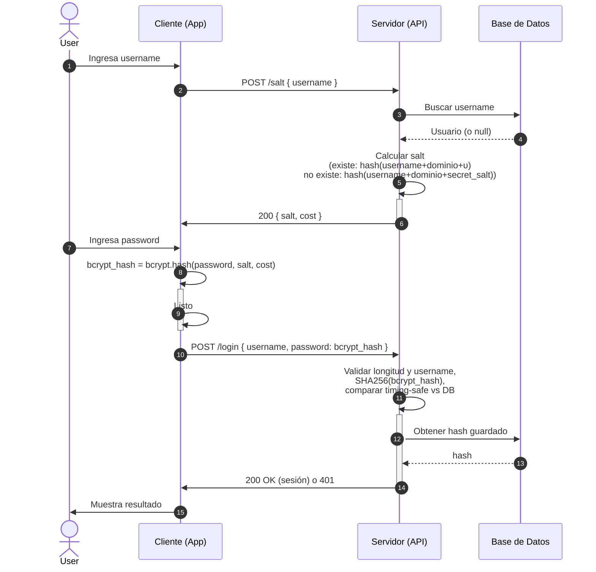

### Como funciona?
El objetivo es muy simple, queremos evitar los aatques de fuerza bruta de un aatcante queremos que el atacnate le cueste tanto pdoer tomar una contraseña que ni quiera intentar mas

password deviration 2: Basado en deviraciones hexadecilames de los anteriroes convinaciones varia el password con el resultadanterior 

Bycript: Similar al anterior pero su crecimiento es exponecial entre mas mas variaciones le pones mas lento y dificil se vuelve decifrarlo.

• Database stores { username, hash(s), υ } 

PFF = ("bycript", PBKDF2,scrypt) debe ser 128 bytes 
υ = userID CSPRNG - 128-bits id unico ususario -- cambia cada vez que el user cambia password
Envio por tsl
hash = cryptographic hash funtion
salt = SHA-256
secret que cambia cada año usado para enviar resuletas en la solciitud de las salt 
where s = PPF(salt, password, cost, misc)


Como funciona ?

**Cliente**: Se encarga del procesamiento del PFF con algoritmos lentos o de crecimiento exponencial (bycipt, script, etc), solicita el salt, cost y otros datos que requieraal backend para:

**Server**: Se encarga de guardar el hash rápido, generar el salt y comparar el hash generado por el cliente con el guardado

1.  `POST:/salt`: Le envía el username  
```json  
{
  "username": "gold"
}
```
2.  Server busca en `DB` por username 
```json  
DB SCHEMA
const secureBytes = new Uint8Array(126); 
{
  "hash": SHA256(bycriptPassword) 
  "username": "gold",
  "user_id": self.crypto.getRandomValues(secureBytes);
}
```

```json
Reponse 200
// Si encuentra el usuario salt=hash(username || "tuapp.com" || υ)
{
"salt":"ba7816bf8f01cfea414140de5dae2223b00361a396177a9cb410ff61f20015ad"
"cost": 10 
...otros parametros
}

// Si NO encuentra el usuario salt=hash(username || "tuapp.com" || secret_salt)
{
"salt":"ga67816bf8f01cfea414140fe5dae2223b00361a396177a9cb410ff61f100015aa"
"cost": 10
...otros parametros
}
```

3.  Cliente ahora aplica el algoritmo de una sola dirección como bycript tomando
```js
const {salt, cost} = responseSalt
const pff_hash = await bycript.hash(password, salt, cost)
```

4.  Cliente envía a `POST:/login`
```json  
{
  "username": "gold"
  "password": pff_hash
}
```

5.  Server compara y responde con exito o error al cliente 
```js
const maxCharsUsername = 20
const maxBytesSizePassword = 32  //Ejemplo para un hash de 256 bits en bytes
const {hash} = db
const {username, password } = request

if (Buffer.byteLength(password, 'hex') !== EXPECTED_PPF_LENGTH) {
    return false; // Rechazo inmediato para evitar DoS [7]
}

if(username.lenght > maxCharsUsername  ){
 return false
}

const client_password_hash = createHash('sha256').update(password).digest('hex')

return client_password_hash === hash
```


#### Requerimientos técnicos

- **υ**: debe ser 100% único por cada usuario y debe cambiar por cada cambio de password mínimo 128 bytes y CSPRNG

- **El server no  guarda el PFF plano**, lo hashea rápido para evitar ataques pass-the-hash al exponerse la db o hash

- **Server siempre responde con el salt**, de ese modo evitamos que el hacker peuda reconocer usuarios validos o no

- **El cliente debe usar algoritmo pesado** **PPF** de mínimo 126 bits

- **El modelo exige TLS** 

- **El PFF recibido no se guarda en logs** 
  
